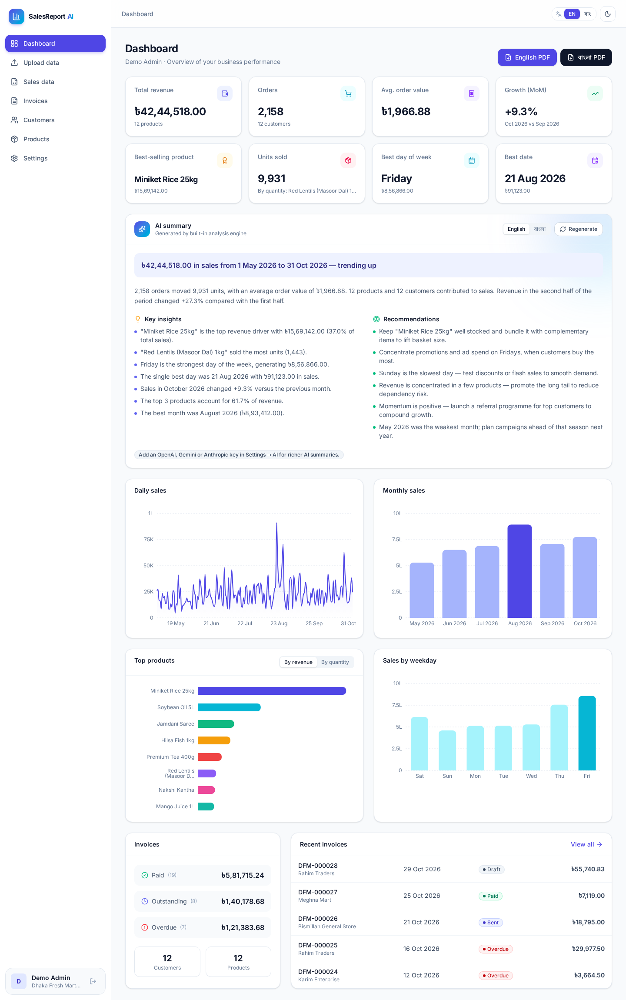
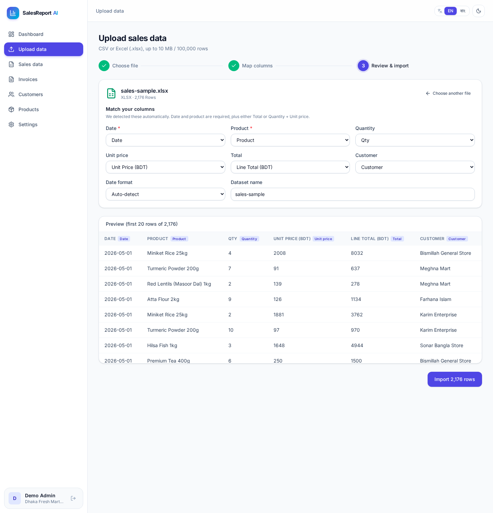
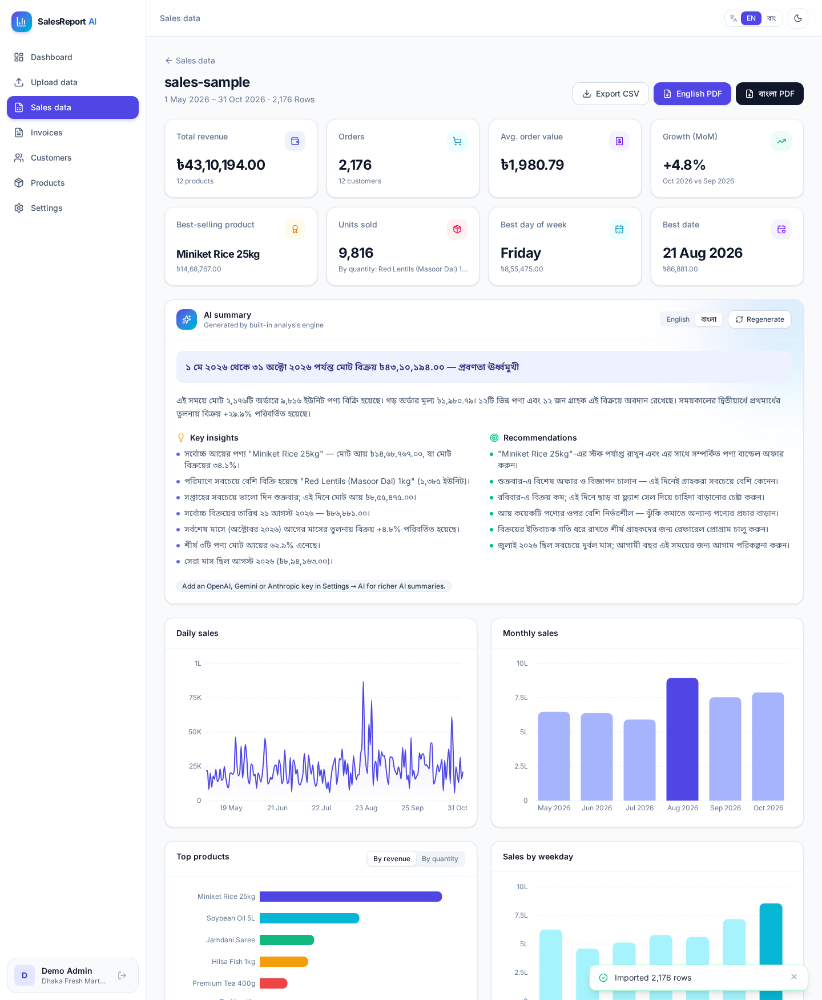
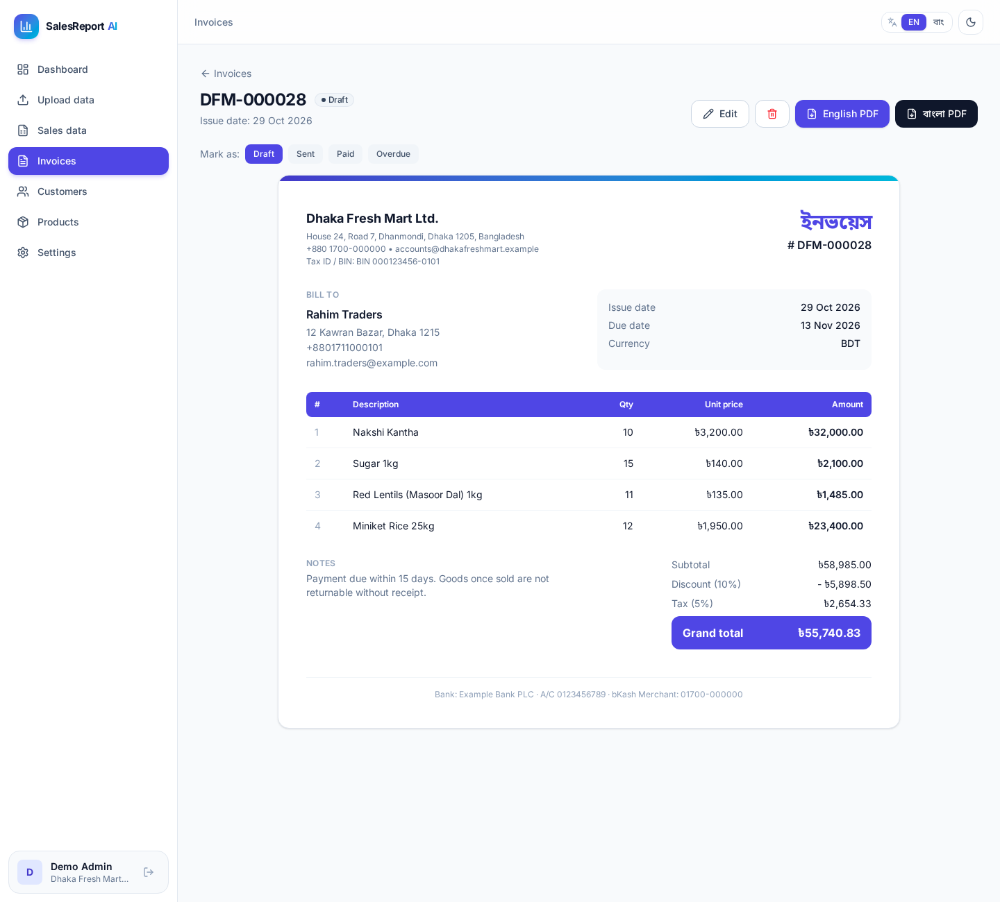
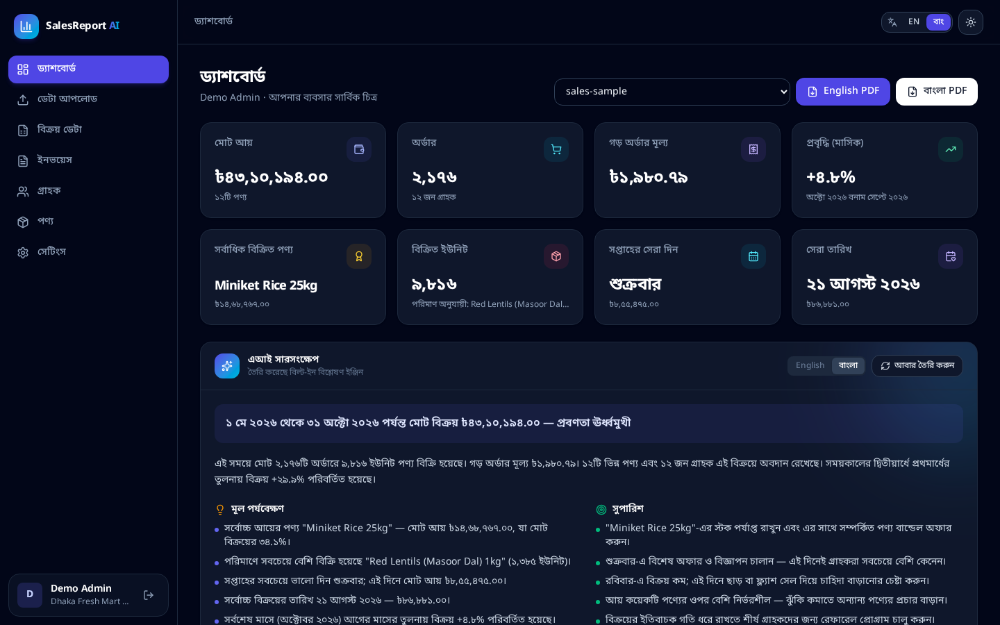
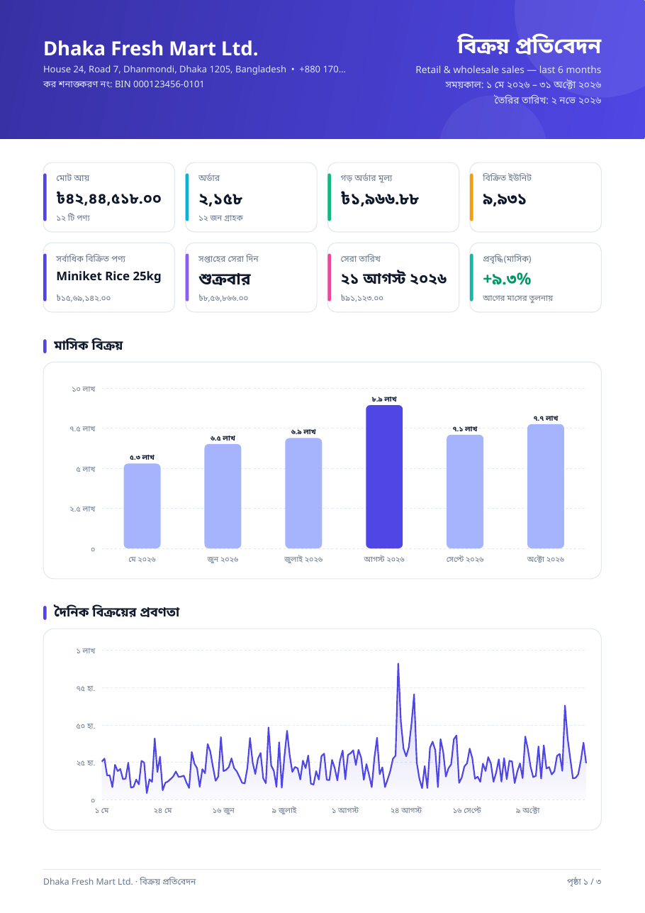

# SalesReport AI

**Upload sales data → get an AI summary → download beautiful PDF reports and invoices. In Bangla and English.**

SalesReport AI is a production-ready, self-hosted SaaS starter for small businesses, distributors and shops. Drop in a CSV or Excel file, map the columns once, and get KPIs, charts, an AI-written narrative with insights and recommendations, and a branded PDF report — in **বাংলা** or **English**. A full invoicing module (customers, products, invoices with tax/discount and PDF) is included.

> Stack: React 18 · Vite · TypeScript · Tailwind CSS v4 · TanStack Query · Express 5 · Prisma · SQLite/PostgreSQL · pdfkit · OpenAI / Gemini / Anthropic

---

## Table of contents

- [Features](#features)
- [Screenshots](#screenshots)
- [Tech stack](#tech-stack)
- [Requirements](#requirements)
- [Quick start (local)](#quick-start-local)
- [Quick start (Docker)](#quick-start-docker)
- [বাংলা দ্রুত শুরু (Bangla quick-start)](#বাংলা-দ্রুত-শুরু-bangla-quick-start)
- [Environment variables](#environment-variables)
- [Adding your own LLM API key](#adding-your-own-llm-api-key)
- [CSV / Excel format](#csv--excel-format)
- [Deployment](#deployment)
- [Security](#security)
- [Folder structure](#folder-structure)
- [Scripts](#scripts)
- [FAQ](#faq)
- [License](#license)
- [Changelog](#changelog)

---

## Features

**Sales analytics & AI**

- CSV and Excel (`.xlsx`) upload with a 3-step wizard: choose file → **auto-detected column mapping** (English _and_ Bangla headers) → preview & import.
- Robust parsing: Bangla digits (১২৩), `৳1,25,000`, European decimals, `(300)` negatives, ISO / DD-MM-YYYY / MM-DD-YYYY / "12 Mar 2026" / Excel serial dates; invalid rows are skipped and reported row-by-row.
- Analytics per dataset: total revenue, order count, average order value, units sold, best-selling product **by revenue and by quantity**, best day of week, best date, daily and monthly trend, month-over-month growth (latest _complete_ month), period growth, top products and top customers.
- **AI summary** (headline, overview, insights, recommendations) written in the selected language by **OpenAI (default), Google Gemini or Anthropic Claude** — provider-agnostic service, configurable from `.env` or the admin Settings page.
- **Always works:** with no API key (or if the provider fails) a deterministic rule-based engine writes the summary in Bangla or English, so the demo never breaks.

**PDF reports & invoices**

- Server-side PDF generation with **pdfkit** — no headless browser required.
- Bundled **Noto Sans Bengali** (SIL OFL) merged with Noto Sans Latin, giving correct Bangla conjunct shaping (ক্ষ, শ্র, স্ত্রী…) and mixed Bangla/English text in one font.
- Branded multi-page sales report: header with logo, 8 KPI cards, monthly bar chart, daily trend chart, AI summary, top products table with share bars, weekday performance, top customers, page numbers.
- Professional invoices: logo + company details, bill-to, line items, discount (fixed or %), tax, totals, notes, footer (bank/bKash details), PAID watermark, Bangla digits in Bangla mode.

**Business admin**

- Customers, products and invoices CRUD with search, filters and pagination.
- Invoices: line items (pick from catalogue or free text), tax, discount, status (draft/sent/paid/overdue — sent invoices past due become overdue automatically), sequential numbering with a custom prefix (`INV-000001`), CSV export.
- Company settings: logo upload, name, address, phone, e-mail, website, tax ID/BIN, currency (BDT ৳ default; USD, EUR, GBP, INR, AED, SAR, MYR, SGD, CAD, AUD), default document language, default tax rate, invoice notes & footer.
- Team: admin & staff roles, invite users, change roles.
- Dashboard with KPI cards, daily/monthly charts, top products, weekday chart, invoice totals and recent invoices.

**UX**

- Full Bangla and English UI with a one-click language toggle (persisted), Bangla digits and lakh/crore grouping (`৳১২,৩৪,৫৬৭.০০`).
- Dark / light mode (persisted, no flash), responsive layout (mobile drawer), accessible components, skeleton loaders, toasts.

**Production & security** (see [Security](#security))

- argon2id passwords, short-lived JWT + rotating refresh tokens with reuse detection, CSRF protection, strict CSP, rate limiting, account lockout, RBAC, per-organization data scoping, upload hardening, AES-256-GCM encrypted API keys, structured logs with redaction, env validation.
- One-service deploy (API serves the built SPA), Dockerfile + docker-compose, Render blueprint, PM2 config, CI workflow, health endpoint, `DEMO_MODE` for public demos.

## Screenshots

> Replace these with your own branding before publishing. All images are in [`docs/screenshots/`](docs/screenshots).

| Dashboard                                                     | Upload & column mapping                                 |
| ------------------------------------------------------------- | ------------------------------------------------------- |
|                |        |
| **Dataset analytics + Bangla AI summary**                     | **Invoice**                                             |
|         |       |
| **Bangla + dark mode**                                        | **Bangla PDF report**                                   |
|  |  |

More: login, invoice list, invoice form, mobile view, PDF page 2 and Bangla PDF invoice.

## Tech stack

| Layer    | Technology                                                                                                                     |
| -------- | ------------------------------------------------------------------------------------------------------------------------------ |
| Frontend | React 18, Vite 8, TypeScript 5.9, Tailwind CSS 4, React Router 7, TanStack Query 5, react-hook-form + zod, Recharts 3, i18next |
| Backend  | Node.js 20+/22, Express 5, TypeScript, Prisma 6, zod 4, pino, helmet, express-rate-limit, multer 2, jose, argon2               |
| Data     | SQLite (default, zero-config) or PostgreSQL                                                                                    |
| Files    | papaparse (CSV), SheetJS (XLSX), pdfkit (PDF)                                                                                  |
| AI       | OpenAI Chat Completions (any OpenAI-compatible endpoint), Google Gemini, Anthropic Messages — via `fetch`, no SDK lock-in      |
| Tooling  | npm workspaces monorepo, shared types package, ESLint 10 (flat config), Prettier, Vitest + Supertest, tsup, Docker             |

## Requirements

- **Node.js 20.11+** (22 LTS recommended) and npm 10+
- No database server needed for SQLite. PostgreSQL 14+ optional.
- Optional: an API key from OpenAI, Google AI Studio (Gemini) or Anthropic.
- Docker 24+ (optional, for container deploys).

## Quick start (local)

```bash
# 1. Unzip and enter the project
cd salesreport-ai

# 2. One-shot setup: creates .env with random secrets, installs, migrates, seeds demo data
npm run setup

# 3. Run API (http://localhost:4000) + web (http://localhost:5173) with hot reload
npm run dev
```

Open **http://localhost:5173** and sign in with the demo account:

| Role  | E-mail              | Password      |
| ----- | ------------------- | ------------- |
| Admin | `demo@example.com`  | `Demo@12345`  |
| Staff | `staff@example.com` | `Staff@12345` |

**Production build (single service):**

```bash
npm run build          # builds web → apps/web/dist and API → apps/server/dist
NODE_ENV=production APP_URL=http://localhost:4000 npm start   # serves API + SPA on :4000
```

## Quick start (Docker)

```bash
cp .env.example .env
# edit .env: set JWT_ACCESS_SECRET (openssl rand -base64 48) and ENCRYPTION_KEY (openssl rand -hex 32)
# optional: SEED_DEMO_DATA=true to load the demo company on first start
docker compose up -d --build
```

App: **http://localhost:4000** · Health: `GET /api/health` · SQLite data is persisted in the `app-data` volume.
Seed demo data manually: `docker compose run --rm seed`.

## বাংলা দ্রুত শুরু (Bangla quick-start)

1. **প্রয়োজনীয়তা:** কম্পিউটারে Node.js 20 বা তার নতুন সংস্করণ (২২ LTS ভালো) ইনস্টল করুন।
2. **সেটআপ:** প্রজেক্ট ফোল্ডারে টার্মিনাল খুলে লিখুন — `npm run setup`। এটি নিজে থেকেই `.env` ফাইল তৈরি করবে (নিরাপদ র‍্যান্ডম সিক্রেটসহ), প্যাকেজ ইনস্টল করবে, ডেটাবেস তৈরি করবে এবং ডেমো ডেটা যোগ করবে।
3. **চালু করুন:** `npm run dev` লিখুন, তারপর ব্রাউজারে **http://localhost:5173** খুলুন।
4. **লগ ইন:** `demo@example.com` / `Demo@12345`
5. **ভাষা পরিবর্তন:** উপরের ডান কোণে **EN | বাং** বাটন চাপুন। আপনার পছন্দ সংরক্ষিত থাকবে।
6. **এআই কী যোগ করুন (ঐচ্ছিক):** `.env` ফাইলে `OPENAI_API_KEY=` এর পরে আপনার কী বসান, অথবা অ্যাপের **সেটিংস → এআই প্রোভাইডার** থেকে কী দিন। কী না দিলেও বিল্ট-ইন ইঞ্জিন বাংলায় সারসংক্ষেপ তৈরি করবে।
7. **ডেটা আপলোড:** **ডেটা আপলোড** মেনু থেকে CSV বা Excel ফাইল দিন। বাংলা কলামের নাম (তারিখ, পণ্য, পরিমাণ, একক মূল্য, মোট, গ্রাহক) স্বয়ংক্রিয়ভাবে চেনা যায়। নমুনা ফাইল `sample-data/` ফোল্ডারে আছে।
8. **PDF ডাউনলোড:** যেকোনো ডেটাসেট বা ইনভয়েস পেজে **বাংলা PDF** বাটন চাপুন।
9. **Docker দিয়ে:** `.env` তৈরি করে `docker compose up -d --build` চালান, তারপর **http://localhost:4000** খুলুন।

## Environment variables

All variables are validated with zod at startup — the server refuses to start with a clear message if something is wrong. See [`.env.example`](.env.example).

| Variable                         | Default                     | Description                                                                                           |
| -------------------------------- | --------------------------- | ----------------------------------------------------------------------------------------------------- |
| `NODE_ENV`                       | `development`               | `development` \| `production` \| `test`                                                               |
| `PORT` / `HOST`                  | `4000` / `0.0.0.0`          | API listen address (in production it also serves the web app)                                         |
| `APP_URL`                        | `http://localhost:5173`     | Public URL. `https://` automatically enables Secure cookies, HSTS and `upgrade-insecure-requests`     |
| `CORS_ORIGINS`                   | origin of `APP_URL`         | Comma-separated allow-list of browser origins                                                         |
| `TRUST_PROXY`                    | `0`                         | Number of reverse proxies (set `1` behind Nginx/Render/Railway) so rate-limits see the real client IP |
| `DATABASE_URL` **required**      | `file:./dev.db`             | SQLite file (relative to `apps/server/prisma/`) or `postgresql://…`                                   |
| `JWT_ACCESS_SECRET` **required** | —                           | ≥ 32 chars. `openssl rand -base64 48`                                                                 |
| `ENCRYPTION_KEY` **required**    | —                           | 32-byte key (64 hex or base64) for AES-256-GCM encryption of stored API keys. `openssl rand -hex 32`  |
| `ACCESS_TOKEN_TTL_SECONDS`       | `900`                       | Access-token lifetime (60–3600)                                                                       |
| `REFRESH_TOKEN_TTL_DAYS`         | `7`                         | Refresh-token lifetime                                                                                |
| `COOKIE_SECURE`                  | `auto`                      | `auto` (true when `APP_URL` is https) \| `true` \| `false`                                            |
| `ALLOW_REGISTRATION`             | `true`                      | Allow public sign-up (each sign-up creates a new organization)                                        |
| `LOGIN_MAX_ATTEMPTS`             | `5`                         | Failed logins before the account is locked                                                            |
| `LOGIN_LOCK_MINUTES`             | `15`                        | Lock duration; doubles for each further failure (max 24 h)                                            |
| `LLM_PROVIDER`                   | `openai`                    | `openai` \| `gemini` \| `anthropic` \| `none`                                                         |
| `LLM_MODEL`                      | provider default            | Defaults: `gpt-4.1-mini`, `gemini-2.5-flash`, `claude-haiku-4-5`                                      |
| `LLM_TIMEOUT_MS`                 | `30000`                     | Provider request timeout                                                                              |
| `OPENAI_API_KEY`                 | —                           | OpenAI key                                                                                            |
| `OPENAI_BASE_URL`                | `https://api.openai.com/v1` | Any OpenAI-compatible endpoint (OpenRouter, Azure proxy, Groq, Ollama…)                               |
| `GEMINI_API_KEY`                 | —                           | Google AI Studio key                                                                                  |
| `ANTHROPIC_API_KEY`              | —                           | Anthropic key                                                                                         |
| `DEMO_MODE`                      | `false`                     | Seeds demo data on start and **wipes + re-seeds all data daily**. Public demos only!                  |
| `DEMO_RESET_HOUR_UTC`            | `0`                         | Hour of the daily demo reset                                                                          |
| `SEED_DEMO_DATA`                 | `false`                     | Seed the demo company once on first start when the DB is empty                                        |
| `SERVE_WEB` / `WEB_DIST_PATH`    | `true` / auto               | Serve the built SPA from the API                                                                      |
| `LOG_LEVEL`                      | `info`                      | pino log level                                                                                        |
| `BODY_LIMIT`                     | `1mb`                       | JSON body size limit                                                                                  |
| `RATE_LIMIT_DISABLED`            | `false`                     | Disable rate limiting (load tests only)                                                               |

## Adding your own LLM API key

You can configure the AI provider in **two ways**. Settings saved in the app override the `.env` defaults.

**Option A — `.env` (server-wide default)**

```env
LLM_PROVIDER=openai          # or gemini / anthropic
OPENAI_API_KEY=sk-...
# LLM_MODEL=gpt-4.1-mini      # optional
```

Restart the server after editing `.env`.

**Option B — Settings → AI provider (admin, per organization)**

1. Sign in as an admin → **Settings → AI provider**.
2. Choose the provider, optionally a model, paste the key and **Save**.
3. Click **Test connection**. The key is encrypted with AES-256-GCM and only a masked form (`sk-p••••••••abcd`) is ever shown again.

**Where to get a key**

| Provider          | Steps                                                                                                                                                                                   |
| ----------------- | --------------------------------------------------------------------------------------------------------------------------------------------------------------------------------------- |
| **OpenAI**        | 1. Sign in at <https://platform.openai.com> 2. Settings → **Billing**: add a payment method/credit 3. <https://platform.openai.com/api-keys> → **Create new secret key** 4. Copy `sk-…` |
| **Google Gemini** | 1. Open <https://aistudio.google.com/app/apikey> 2. **Create API key** (choose or create a Google Cloud project) 3. Copy the key. A free tier is available in many regions.             |
| **Anthropic**     | 1. Sign in at <https://console.anthropic.com> 2. **Plans & Billing**: add credit 3. <https://console.anthropic.com/settings/keys> → **Create Key** 4. Copy `sk-ant-…`                   |

Cost tip: a summary prompt is ~1–2k tokens. With the default small models this costs a fraction of a cent per summary. Summaries are cached per dataset and language; **Regenerate** creates a fresh one.

If a call fails (bad key, quota, timeout) the app falls back to the built-in engine and shows the reason — it never breaks the page.

## CSV / Excel format

- One header row, then one row per sale/order line. First worksheet is used for `.xlsx`.
- Max **10 MB** and **100,000 rows** (change in `packages/shared/src/constants.ts`). UTF-8 CSV recommended (a BOM is fine).

| Field       | Required | Accepted header names (auto-detected, case-insensitive)            | Example values                                                      |
| ----------- | -------- | ------------------------------------------------------------------ | ------------------------------------------------------------------- |
| `date`      | ✅       | Date, Order Date, Sale Date, Invoice Date, Transaction Date, তারিখ | `2026-03-15`, `15/03/2026`, `15 Mar 2026`, `১৫/০৩/২০২৬`, Excel date |
| `product`   | ✅       | Product, Product Name, Item, Description, পণ্য, পণ্যের নাম         | `Miniket Rice 25kg`, `মসুর ডাল ১ কেজি`                              |
| `quantity`  | ◻️       | Quantity, Qty, Units, Units Sold, পরিমাণ                           | `2`, `1.5`, `১০`                                                    |
| `unitPrice` | ◻️       | Unit Price, Price, Rate, একক মূল্য, দাম                            | `1950`, `৳1,950.00`                                                 |
| `total`     | ◻️ \*    | Total, Amount, Line Total, Revenue, Sales, মোট, মোট মূল্য          | `3900`, `1,25,000`, `(300)`                                         |
| `customer`  | ◻️       | Customer, Customer Name, Client, Buyer, গ্রাহক, ক্রেতা             | `Rahim Traders`                                                     |

\* Map **Total**, or both **Quantity** and **Unit price** (total is then computed). If quantity is missing it defaults to 1.
Ambiguous dates like `04/05/2026` are auto-detected across the file (default: day-first, the Bangladesh convention) or can be forced in the mapping step.

Samples: [`sample-data/sales-sample.csv`](sample-data/sales-sample.csv), [`sales-sample.xlsx`](sample-data/sales-sample.xlsx), [`sales-sample-bangla.csv`](sample-data/sales-sample-bangla.csv) (Bangla headers, digits and DD/MM/YYYY). Regenerate with `npm run sample-data`.

## Deployment

Full guides with copy-paste commands: **[docs/DEPLOYMENT.md](docs/DEPLOYMENT.md)** (Render, Railway, VPS with Nginx + PM2, Docker, PostgreSQL).

Summary: the API serves the built React app, so you deploy **one service**:

```bash
npm ci && npm run build
cd apps/server && npx prisma migrate deploy && node dist/index.js
```

Behind a proxy set `TRUST_PROXY=1` and `APP_URL=https://your-domain`.

## Security

| Area          | Implementation                                                                                                                                                                                                                                                             |
| ------------- | -------------------------------------------------------------------------------------------------------------------------------------------------------------------------------------------------------------------------------------------------------------------------- |
| Passwords     | argon2id (OWASP parameters); policy: 10–128 chars with upper, lower, digit and symbol                                                                                                                                                                                      |
| Sessions      | 15-min JWT access token (memory only, never localStorage) + 7-day refresh token in an `httpOnly`, `Secure`, `SameSite=Strict` cookie scoped to `/api/auth`; refresh tokens are stored hashed (SHA-256), **rotated on every use**, and reuse revokes the whole token family |
| CSRF          | Cookie-authenticated endpoints (`/auth/refresh`, `/auth/logout`) require a double-submit token (`__Host-` cookie in production) + Origin allow-list + SameSite=Strict                                                                                                      |
| Brute force   | Per-IP rate limits (strict on auth, AI and uploads) + per-account progressive lockout; no user enumeration (constant-time dummy hash)                                                                                                                                      |
| Headers       | helmet with a strict CSP (`script-src 'self'`, no inline scripts, `frame-ancestors 'none'`), HSTS on https, Referrer-Policy, Permissions-Policy                                                                                                                            |
| Authorization | RBAC (`admin`, `staff`) middleware; every query scoped by `organizationId` (no IDOR) — covered by tests                                                                                                                                                                    |
| Input         | zod validation of every body, query and param; body size limits; Prisma parameterized queries (no raw SQL with user input)                                                                                                                                                 |
| Uploads       | multer in-memory, size/count limits, extension + MIME allow-list **and** magic-byte sniffing; logos PNG/JPEG only (no SVG); served with `sandbox` CSP                                                                                                                      |
| Exports       | CSV formula-injection neutralization (`=`, `+`, `-`, `@`, tab, CR)                                                                                                                                                                                                         |
| Secrets       | LLM keys encrypted with AES-256-GCM (org-bound AAD), never returned to the browser (masked only); `.env` never committed                                                                                                                                                   |
| Errors & logs | Central error handler, no stack traces in production; pino structured logs with redaction of auth headers, cookies, passwords, keys                                                                                                                                        |
| Config        | zod env validation at startup; refuses example secrets in production                                                                                                                                                                                                       |
| Dependencies  | `npm audit` → **0 vulnerabilities** at release                                                                                                                                                                                                                             |

More details and a hardening checklist: **[docs/SECURITY.md](docs/SECURITY.md)**.

## Folder structure

```
salesreport-ai/
├── apps/
│   ├── server/                 # Express 5 API
│   │   ├── prisma/             # schema.prisma, migrations, seed.ts
│   │   ├── assets/fonts/       # Noto Sans Bengali (+Latin) for PDFs, OFL licence
│   │   ├── scripts/            # sample-data generator, switch to PostgreSQL
│   │   ├── src/
│   │   │   ├── config/env.ts   # zod-validated environment
│   │   │   ├── lib/            # prisma, logger, crypto, errors, csv, validation helpers
│   │   │   ├── middleware/     # auth/RBAC, CSRF, rate limits, uploads, error handler
│   │   │   ├── modules/        # feature modules: routes → controller → service → repository
│   │   │   │   ├── auth/ users/ organization/ customers/ products/ invoices/
│   │   │   │   ├── datasets/   # parser, normalizer, analytics
│   │   │   │   ├── ai/         # provider-agnostic LLM service, rule-based engine
│   │   │   │   └── pdf/        # report + invoice renderers, theme, i18n
│   │   │   ├── demo/           # demo data generator, seed, DEMO_MODE scheduler
│   │   │   ├── app.ts          # Express app (security middleware, routes, SPA)
│   │   │   └── index.ts        # bootstrap & graceful shutdown
│   │   └── test/               # vitest + supertest
│   └── web/                    # React 18 + Vite SPA
│       └── src/
│           ├── components/     # ui kit, layout, charts
│           ├── features/       # auth, dashboard, datasets, invoices, customers, products, settings
│           ├── i18n/           # i18next setup + en.json / bn.json
│           └── lib/            # api client, auth, theme, formatting, toasts
├── packages/shared/            # zod schemas, types, invoice math, formatting (used by both apps)
├── sample-data/                # sample CSV/XLSX
├── docs/                       # API, customization, deployment, security, screenshots
├── Dockerfile · docker-compose.yml · render.yaml · ecosystem.config.cjs
└── .env.example
```

## Scripts

| Command                           | Description                                              |
| --------------------------------- | -------------------------------------------------------- |
| `npm run setup`                   | Create `.env` (random secrets), install, migrate, seed   |
| `npm run dev`                     | API (tsx watch) + web (Vite) with hot reload             |
| `npm run build`                   | Production build of web and API                          |
| `npm start`                       | Run migrations and start the production server           |
| `npm test`                        | Shared + server tests (Vitest/Supertest)                 |
| `npm run lint` / `lint:fix`       | ESLint                                                   |
| `npm run format` / `format:check` | Prettier                                                 |
| `npm run typecheck`               | TypeScript in all workspaces                             |
| `npm run db:migrate`              | Apply migrations                                         |
| `npm run db:seed`                 | Seed demo data (idempotent)                              |
| `npm run db:reset`                | Drop all data, re-migrate and re-seed                    |
| `npm run db:studio`               | Prisma Studio                                            |
| `npm run sample-data`             | Regenerate `/sample-data`                                |
| `npm run env:init`                | Create `.env` from `.env.example` with generated secrets |

## FAQ

**Does it work without an AI key?** Yes. The built-in engine writes a full summary (Bangla or English) from the analytics. Add a key any time for richer, more natural summaries.

**Is my data sent to the AI provider?** Only aggregated analytics (totals, top products/customers, monthly figures) — never the raw rows. Customer names in the top-customers list are included; remove them in `apps/server/src/modules/ai/summary.service.ts` (`analyticsForPrompt`) if needed.

**Can I use PostgreSQL?** Yes — see [docs/CUSTOMIZATION.md → Switching to PostgreSQL](docs/CUSTOMIZATION.md#switching-to-postgresql).

**Why does Bangla render correctly in PDFs?** The bundled font is Noto Sans Bengali merged with Latin glyphs, and pdfkit's fontkit engine applies the OpenType Bengali shaping rules (reph, pre-base vowels, conjuncts).

**How do I rebrand / add a language / change the default currency?** See [docs/CUSTOMIZATION.md](docs/CUSTOMIZATION.md).

**Is it multi-tenant?** Each registration creates an organization; users, customers, products, invoices and datasets are isolated per organization. Admins add staff from Settings → Team.

**What does `DEMO_MODE` do?** Seeds demo data, shows demo credentials on the login page and a banner, disables saving API keys and changing demo passwords, and wipes + re-seeds **all** data daily. Never enable it on a real installation.

**Which browsers are supported?** Current Chrome, Edge, Firefox and Safari (desktop and mobile).

## License

This product is sold under a **commercial license**. See [LICENSE.md](LICENSE.md) — _placeholder: replace with the license terms of your marketplace purchase (e.g. single/extended use)._
Bundled fonts are © The Noto Project Authors, licensed under the SIL Open Font License 1.1 (`apps/server/assets/fonts/OFL.txt`). Third-party npm packages retain their own licenses.

## Changelog

See [CHANGELOG.md](CHANGELOG.md). Current version: **1.0.0**.
