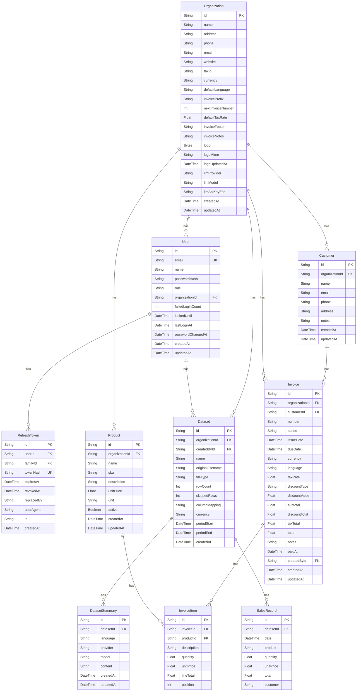

# Entity Relationship Diagram

Generated from `apps/server/prisma/schema.prisma`. Every business table is scoped by `organizationId` (multi-tenant). Full SQL: `database/schema.sql`; migrations: `apps/server/prisma/migrations/`.

## Tables

| Table | Purpose |
|---|---|
| Organization | Tenant / company profile, invoice branding, encrypted AI key |
| User | Login accounts (argon2id hash), role admin/staff, lockout |
| RefreshToken | Rotating refresh tokens with family reuse detection |
| Customer | Customers per organization |
| Product | Product catalogue per organization |
| Invoice | Invoices with totals, status, tax |
| InvoiceItem | Line items of an invoice |
| Dataset | One uploaded CSV/XLSX file |
| SalesRecord | Normalised sales rows of a dataset |
| DatasetSummary | Cached analytics + AI summary of a dataset |
